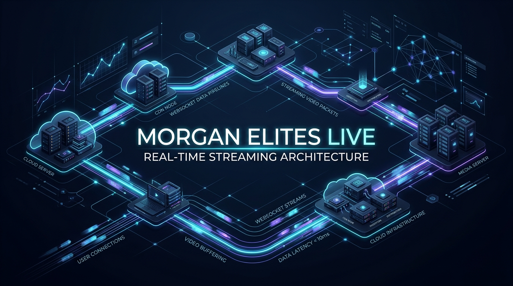

# 🎥 Morgan Elites Live — Real-Time Streaming & Interactive Engine



<p align="center">
  <a href="https://app.getpostman.com/run-collection/48491387-4c3c59b0-90ad-4c82-a997-efc666b89020?action=collection%2Ffork&source=rip_markdown&collection-url=entityId%3D48491387-4c3c59b0-90ad-4c82-a997-efc666b89020%26entityType%3Dcollection%26workspaceId%3D9f9f8d90-6e2c-4bea-81e2-30710035ed17">
    
  </a>
</p>

<p align="center">
  
  
  
  
  
  
  
  
  
</p>

---

## 📌 Executive Overview

**Morgan Elites Live** is an enterprise-grade backend infrastructure engineered for high-concurrency real-time live streaming, interactive audience engagement, creator monetization, and community management. 

Designed with a scalable modular architecture, the system coordinates low-latency WebSocket signaling, asynchronous background message processing, FFmpeg video processing, and secure financial transactions through Stripe.

---

## 🚀 Key Technical Highlights & Architecture

### 1. Low-Latency Real-Time State Synchronization (`ws`)
* **Live Session Coordination**: Handles simultaneous host-viewer streaming state, live presence tracking, viewer join/leave handshakes, and broadcast status.
* **Interactive Live Features**: Powers real-time live polling, in-stream chat feeds, interactive attendee reactions, and instant notifications.

### 2. Distributed Queue & Worker Pipeline (BullMQ + Redis)
* **Decoupled Architecture**: High-frequency operational tasks (email delivery, transcoding hooks, notification fanouts) are offloaded to dedicated BullMQ workers (`src/workers/emailWorker.ts`).
* **Telemetry & Dashboard**: Integrated `@bull-board/express` dashboard for real-time queue health monitoring, job retry inspection, and dead-letter queue management.

### 3. Media Ingestion & Video Processing (FFmpeg + AWS S3)
* **Automated Processing**: Leverages `fluent-ffmpeg` and `ffmpeg-static` for programmatic media transcoding, thumbnail extraction, and resolution validation.
* **Cloud Storage**: Multipart cloud storage pipelines using AWS SDK v3 (`@aws-sdk/client-s3`, `@aws-sdk/lib-storage`).

### 4. Creator Monetization & Secure Billing (Stripe SDK)
* **Donations & Tips**: Real-time viewer-to-creator live stream tipping with automated fee calculation.
* **Tiered Subscriptions**: Webhook-driven recurring membership subscriptions with automated entitlement verification.

### 5. Type-Safe Data Layer & Security
* **Prisma 6 + MongoDB**: Fully typed schema models, robust indexing, and transaction guarantees.
* **Defense in Depth**: Zod schema validation on incoming payloads, JWT authentication with token rotation, bcrypt password hashing, and role-based access control (RBAC).

---

## 📬 API Documentation & Postman Integration

The complete REST API collection is published and available for interactive testing:

* 🌐 **Live Postman Web Collection**: [Explore Morgan Elites Live in Postman](https://www.postman.com/shahjalal-backend/workspace/morgan-elits-live/collection/48491387-4c3c59b0-90ad-4c82-a997-efc666b89020)
* 📁 **Local Collection File**: [`docs/postman_collection.json`](./docs/postman_collection.json) (import directly into Postman Desktop or CLI).

### Core Endpoint Modules

| Module | Base Route | Key Capabilities |
|---|---|---|
| **Authentication** | `/api/v1/auth` | User registration, login, JWT refresh token, password recovery |
| **Live Broadcasts** | `/api/v1/live` | Session lifecycle (start, pause, end), token generation, live viewers count |
| **Live Polls** | `/api/v1/polls` | Create interactive polls, submit votes, real-time result aggregation |
| **Events & Scheduling** | `/api/v1/event` | Scheduled broadcasts, RSVP management, calendar event alerts |
| **Community Feed** | `/api/v1/post` | Multimedia feeds, comments, likes, and engagement metrics |
| **Groups** | `/api/v1/group` | Community groups, membership moderation, private channels |
| **Donations** | `/api/v1/donation` | Direct creator tips during live streams via Stripe |
| **Subscriptions** | `/api/v1/subscription`| Tiered memberships, recurring billing, and Stripe webhook handling |
| **Notifications** | `/api/v1/notification`| Push notifications and user-specific event alerts |
| **Moderation** | `/api/v1/report` | Content and user reporting, admin review endpoints |

---

## 📂 Project Architecture

```plaintext
morgan_elites_live/
├── assets/
│   └── banner.jpg               # Architecture visual banner
├── docs/
│   └── postman_collection.json  # Full Postman API collection v2.1
├── src/
│   ├── app/
│   │   ├── middlewares/         # Global error handlers, auth & validation guards
│   │   ├── modules/             # Domain-driven feature modules
│   │   │   ├── auth/            # Authentication & JWT
│   │   │   ├── donation/        # Stripe live stream tips
│   │   │   ├── event/           # Scheduled broadcast events
│   │   │   ├── group/           # Communities & Groups
│   │   │   ├── live/            # Real-time streaming coordinator
│   │   │   ├── notification/    # Push notifications
│   │   │   ├── polls/           # In-stream live polling
│   │   │   ├── post/            # Social media & community feeds
│   │   │   ├── report/          # Moderation & compliance
│   │   │   ├── socket/          # WebSocket signaling handlers
│   │   │   ├── subscription/    # Stripe recurring billing
│   │   │   └── user/            # Profile & identity management
│   │   └── routes/              # Centralized route aggregator
│   ├── config/                  # Environment & external service configurations
│   ├── server.ts                # Application bootstrapper & HTTP/WebSocket server
│   └── workers/
│       └── emailWorker.ts       # BullMQ background job worker
├── prisma/
│   └── schema.prisma            # MongoDB database schema definition
├── .env.example                 # Sanitized environment template
├── package.json
└── tsconfig.json
```

---

## 🛠️ Quickstart & Local Setup

### Prerequisites
* **Node.js**: `v20.x` or higher
* **MongoDB**: `v6.x` or higher
* **Redis**: `v6.x` or higher (required for BullMQ queue management)

### 1. Clone & Install Dependencies
```bash
git clone https://github.com/shahjalal-labs/morgan_elites_live.git
cd morgan_elites_live
npm install
```

### 2. Environment Configuration
Copy the provided `.env.example` file to create your local `.env`:
```bash
cp .env.example .env
```
Populate `.env` with your local MongoDB connection string, Redis host/port, JWT secrets, and Stripe API keys.

### 3. Initialize Prisma Client
```bash
npx prisma generate
```

### 4. Run Development Server
Launches the Express HTTP API, WebSocket server, and BullMQ background worker concurrently:
```bash
npm run dev
```

* API Server: `http://localhost:5000`
* WebSocket Server: `ws://localhost:5000`

---

## 👨‍💻 Engineering & Authorship

Developed and maintained by **Md. Shahjalal**.

* **GitHub**: [@shahjalal-labs](https://github.com/shahjalal-labs)
* **Email**: [muhommodshahjalal@gmail.com](mailto:muhommodshahjalal@gmail.com)

---

## 📄 License

This project is licensed under the [ISC License](LICENSE).
